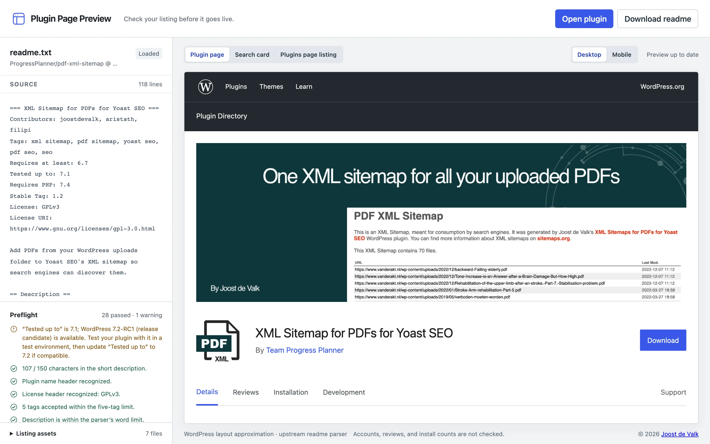
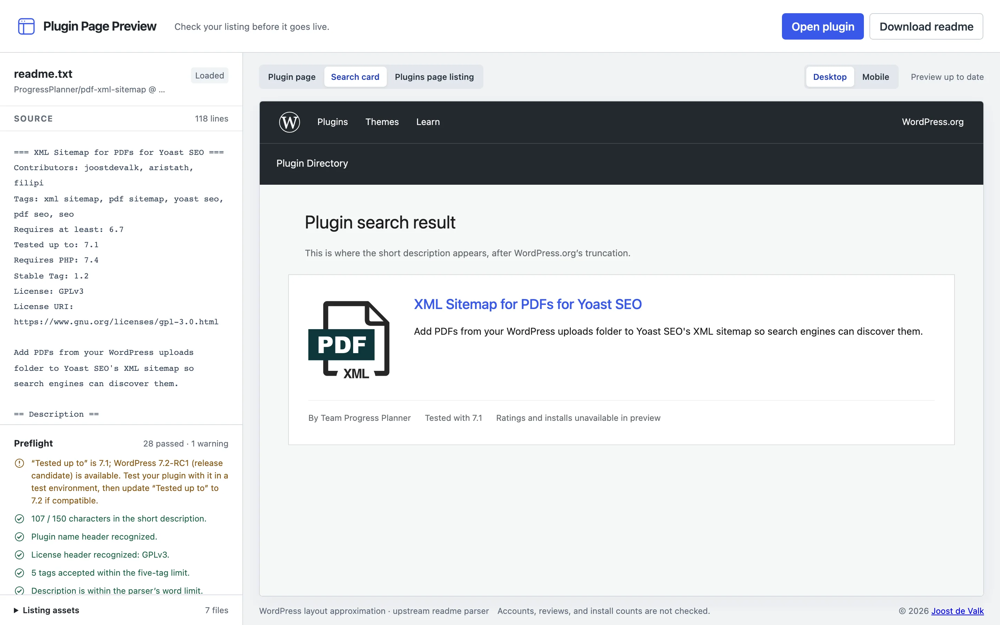
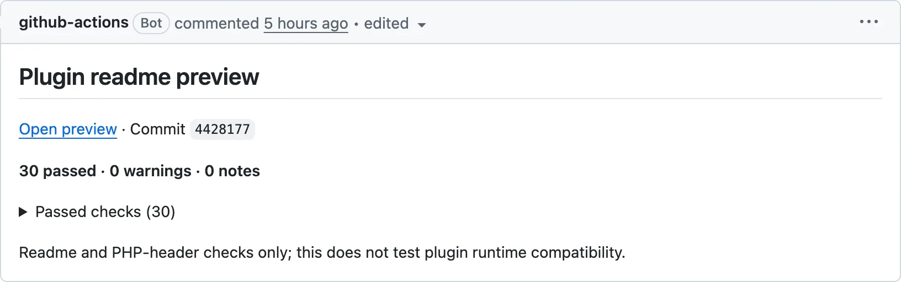

Almost three years ago I wrote about the [GitHub Actions I use to keep a WordPress plugin healthy](/github-actions-wordpress/). Everything in that post checks code: coding standards, linting, tests, lock files. None of it looks at your `readme.txt`, even though that file decides what your plugin looks like on WordPress.org.

Today I built two things to fix that. The first is [Plugin Page Preview](https://github.com/jdevalk/plugin-page-preview), a tool that shows your WordPress.org listing before you release, with a GitHub Action that comments on pull requests. The second is a small workflow that syncs readme changes to WordPress.org without a release.

## A page you can't see until it's live

Your `readme.txt` becomes your plugin page: the description, the FAQ, the changelog, the screenshots and the compatibility data in the sidebar. The trouble is that you only see the rendered result after you've released. A short description that gets cut off, a screenshot caption without an image, a stable tag that doesn't match the version in your PHP header: you find those on the live page, or your users do.

## Plugin Page Preview

[readme.joost.blog](https://readme.joost.blog/) solves that. Open a plugin folder, choose or paste a readme, or paste a link to a public GitHub repository. You get three views, at desktop and mobile widths:

- the plugin page on WordPress.org;
- the search result card;
- the row in the WordPress admin Plugins screen, which comes from your PHP headers, so it needs the plugin folder and not just a readme.



The search card view shows your short description the way it appears in plugin search, after WordPress.org's truncation:



The preview uses the actual WordPress.org readme parser. That parser is PHP, and it runs in your browser through [WordPress Playground](/plugin-demos-with-the-wordpress-playground/)'s WebAssembly runtime. There is no server doing the parsing, so your local files never leave your device.

The layout approximates WordPress.org, it doesn't copy it. Ratings, install counts and reviews are not there, because I didn't want to invent numbers.

## Preflight checks

Next to the preview you get a list of checks:

- the length of the short description, and whether it gets truncated;
- whether the stable tag matches the version in the PHP header;
- whether "Requires at least" and "Requires PHP" agree between the readme and the PHP header;
- whether "Tested up to" matches the latest WordPress major release, checked live against WordPress.org;
- whether the first changelog entry matches the version you're releasing;
- whether the banner, icon and every numbered screenshot actually load.

These are my quality checks, not WordPress.org's rules. Passing all of them doesn't mean your plugin gets approved.

## A preview on every pull request

The same checks run as a GitHub Action. Add this workflow to your plugin's repository:

```yaml
name: Plugin readme preview

on:
  pull_request_target:
    types: [opened, synchronize, reopened, ready_for_review]
    paths:
      - '**/readme.txt'
      - '**/README.txt'
      - '**/readme.md'
      - '**/README.md'
      - '**/*.php'
      - '**/.wordpress-org/**'
      - '**/assets/**'

permissions:
  contents: read
  pull-requests: write

concurrency:
  group: readme-preview-${{ github.event.pull_request.number }}
  cancel-in-progress: true

jobs:
  preview:
    if: github.event.repository.private == false
    runs-on: ubuntu-24.04
    steps:
      # No checkout or execution of pull-request code. The action reads files as data.
      - uses: jdevalk/plugin-page-preview@v1
```

Every pull request that touches the readme, a PHP file or your listing assets now gets a comment. It contains a preview link for that exact commit, the warnings, and a collapsed list of passing checks. [Here's what that looks like](https://github.com/ProgressPlanner/pdf-xml-sitemap/pull/14#issuecomment-6949305682) on our PDF XML Sitemap plugin:



The comment updates itself with every new commit.

A few things to know:

- The pull request comments only work for public repositories, because the preview link loads the files from GitHub in your browser. For a private plugin, open the folder on [readme.joost.blog](https://readme.joost.blog/) instead. Nothing gets uploaded, the entire thing runs in your browser.
- Warnings don't fail the job. This is advice, not a gate. Only a readme that can't be imported or parsed fails it.
- The workflow uses `pull_request_target`, so it can comment on pull requests from forks. That's safe here because there is no checkout step: the action reads the files as data and never runs code from the pull request. Don't add steps to this job that do.

The [full example workflow](https://github.com/jdevalk/plugin-page-preview/blob/main/docs/plugin-repository-workflow.yml) and the [setup docs](https://github.com/jdevalk/plugin-page-preview/blob/main/docs/github-action.md) cover plugins in a subdirectory and pinning the action to a commit.

It sits nicely next to the Playground comment from my earlier post. One comment lets you test the code, the other shows you the listing.

## Syncing the readme without a release

The second thing I built solves a smaller annoyance. A new WordPress version comes out, you test your plugin, and all you need to change is the "Tested up to" line. WordPress.org reads that from the readme in your stable tag, not from trunk. So you either release a new version for a one-line change, or you get out Subversion and edit two files by hand.

The [readme sync workflow](https://github.com/ProgressPlanner/pdf-xml-sitemap/blob/main/.github/workflows/readme-sync.yml) does that work for me. I start it manually from the Actions tab, and it copies `readme.txt` from `main` to both trunk and the current stable tag, in one SVN commit. No plugin code gets published.

The [script behind it](https://github.com/ProgressPlanner/pdf-xml-sitemap/blob/main/.github/scripts/sync-readme.sh) is deliberately careful:

- It only updates a release that already exists. It never creates a tag or switches the stable tag.
- It stops if the stable tag in your local readme differs from the one published in trunk and in the tag.
- It skips the commit when nothing changed.
- It shares a concurrency group with the deploy workflow, so a sync and a release can't run at the same time.

This one is not a reusable action. It's a workflow file and a shell script, so copy both and change the plugin slug in the SVN URL, the commit message and the concurrency group. It only runs from `main`, so adjust that too if your default branch has another name. It uses the same `SVN_USERNAME` and `SVN_PASSWORD` secrets as [10up's deploy action](https://github.com/10up/action-wordpress-plugin-deploy).

10up also has an [action for readme and asset updates](https://github.com/10up/action-wordpress-plugin-asset-update), which runs on every push to your release branch and handles your listing assets too. Mine is narrower: it's manual, and it only touches the readme.

## How they fit together

A readme change now goes like this. I open a pull request, the comment shows me what the plugin page will look like and what's wrong with it, I merge, and I run the sync. The listing on WordPress.org is updated without a release, and without me touching Subversion.

Both are free to use. If you try the preview and it gets something wrong compared to your live plugin page, [open an issue](https://github.com/jdevalk/plugin-page-preview/issues).
